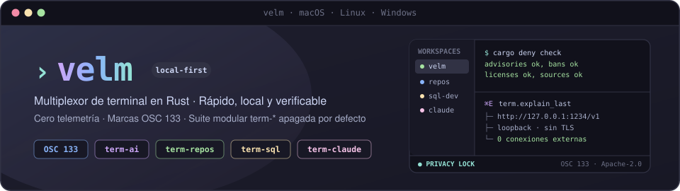
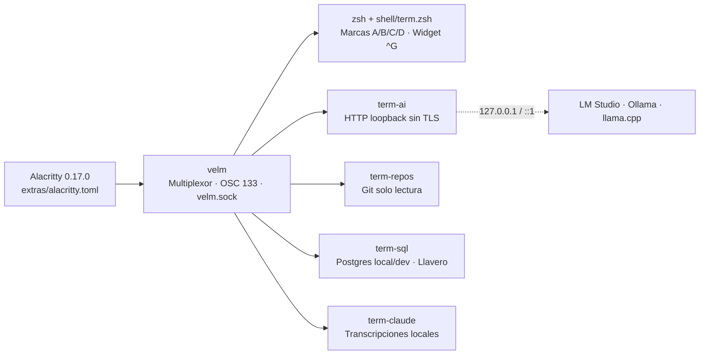

<div align="center">



<br />
<br />

[](https://github.com/Nokky21/velm/actions/workflows/term-ci.yml)
-1e1e2e?logo=apple&logoColor=cdd6f4&labelColor=313244)


[](LICENSE)

<p>
  <strong>Multiplexor de terminal en Rust para el día a día en macOS (Apple Silicon) dentro de <a href="https://alacritty.org/">Alacritty</a></strong>,<br />
  acompañado de herramientas locales desacopladas (<code>term-*</code>) con <strong>privacidad verificable</strong> y bajo consumo de memoria.
</p>

<p>
  <a href="#arquitectura">Arquitectura</a> ·
  <a href="#suite-modular-term-">Suite <code>term-*</code></a> ·
  <a href="#instalación-macos-apple-silicon">Instalación</a> ·
  <a href="#atajos-de-teclado">Atajos</a> ·
  <a href="#verificación-de-privacidad">Privacidad</a> ·
  <a href="#medición-de-memoria">Memoria</a> ·
  <a href="#documentación">Documentación</a>
</p>

</div>

---

> **Sobre el fork:** `velm` es un fork de [`herdrdev/herdr`](https://github.com/herdrdev/herdr) (`v0.9.5`) bajo licencia [Apache-2.0](LICENSE). Consulta [NOTICE](NOTICE) para ver la atribución completa y el inventario exacto de ficheros modificados y añadidos.

## Por qué `velm`

| Principio | Qué garantiza en la práctica |
|---|---|
| **Privacidad verificable** | Sin telemetría, sin comprobación de actualizaciones (`update` eliminado) y sin descarga remota de plugins. Auditado en CI con `cargo-deny`, chequeo estático de código y monitorización `lsof`. |
| **Modular y opt-in** | Todas las herramientas `crates/term-*` arrancan apagadas (`enabled = false`). Activas solo lo que usas en `~/.config/velm/config.toml`. |
| **Ligero sobre Alacritty** | Usa **Alacritty `0.17.0`** oficial sin parchear junto con [`extras/alacritty.toml`](extras/alacritty.toml), conservando `@ # [ ] { } \| \ ~ €` con `Option` derecha en teclado español (`option_as_alt = "OnlyLeft"`). |
| **Semántica de shell (`OSC 133`)** | [`shell/term.zsh`](shell/term.zsh) emite marcas `OSC 133` (`A`/`B`/`C`/`D`) para copiar o explicar la salida del último comando al instante. |
| **Aislado de `herdr`** | Configuración propia en `~/.config/velm/config.toml` y sockets propios (`velm.sock`, `velm-client.sock`). Ignora silenciosamente la sección `[term]`. |

---

## Arquitectura



---

## Suite modular `term-*`

Todas las herramientas comparten validación centralizada en [`crates/term-config`](crates/term-config) y permanecen desactivadas por defecto (`enabled = false`).

| Herramienta | Qué hace | Política de red / seguridad | Salida | Guía |
|---|---|---|---|---|
| **`term-ai`** | Sugiere comandos en `zsh` (`Ctrl+G`), explica la salida del último comando (`term.explain_last`), diagnostica (`doctor`) y ejecuta batería (`bench`). | **Solo HTTP en loopback** (`127.0.0.1`, `::1`, `localhost`), `ureq` compilado **sin TLS**, sin redirecciones. Comenta con `#` comandos destructivos. | CLI / streaming | [docs/asistente.md](docs/asistente.md) |
| **`term-repos`** | Panel TUI para ver estado, ramas, cambios y worktrees de tus repositorios Git locales en paralelo. | **Solo lectura.** Invoca `git` con `GIT_OPTIONAL_LOCKS=0` y `GIT_TERMINAL_PROMPT=0`. Red solo si pulsas `r`. | TUI / `--json` | [docs/repos.md](docs/repos.md) |
| **`term-sql`** | Cliente TUI de Postgres para entornos `local` y `dev` con modo lectura por defecto y escritura controlada (`F2`). | **`env = "prod"` prohibido.** Credenciales solo en el **Llavero de macOS**. Análisis AST (`sqlparser`), confirmaciones explícitas y cuenta atrás de transacción. | TUI / CLI `conn` | [docs/sql.md](docs/sql.md) |
| **`term-claude`** | Supervisa sesiones de Claude Code desde `~/.claude/projects`: contexto actual, tokens, `sidechain` y coste. | **Solo lectura local** y cero red. Deduplicación estricta por `message.id`, cálculo por `cost-state` o precios configurados y alerta de contexto. | TUI / `--json` | [docs/claude.md](docs/claude.md) |

---

## Instalación (macOS Apple Silicon)

### 1. Requisitos previos

- **macOS en Apple Silicon (`arm64`)** y Xcode Command Line Tools (`xcode-select --install`).
- **Rust `1.96.1`** (fijado automáticamente por [`rust-toolchain.toml`](rust-toolchain.toml)).
- **Zig `0.16.0`** en el `PATH` (requerido por [`crates/ghostty-vt/build.rs`](crates/ghostty-vt/build.rs) para compilar `libghostty-vt`).

### 2. Instalar Alacritty `0.17.0`

> [!NOTE]
> El cask de Homebrew `alacritty` está deshabilitado desde el 2026-09-01 por Gatekeeper. Instala Alacritty `0.17.0` desde el **DMG oficial** en las [releases de Alacritty](https://github.com/alacritty/alacritty/releases/tag/v0.17.0).

Copia la configuración recomendada (tema Catppuccin Mocha, `option_as_alt = "OnlyLeft"` y atajos `Cmd+*`):

```bash
mkdir -p ~/.config/alacritty
cp extras/alacritty.toml ~/.config/alacritty/alacritty.toml
```

### 3. Instalar `velm` y las herramientas `term-*`

Puedes descargar el binario precompilado `macos-arm64` cuando haya una release publicada en [GitHub Releases](https://github.com/Nokky21/velm/releases), o compilar e instalar desde la raíz del repositorio:

```bash
cargo install --path . --locked
cargo install --path crates/term-ai --locked
cargo install --path crates/term-repos --locked
cargo install --path crates/term-sql --locked
cargo install --path crates/term-claude --locked
```

Asegúrate de que `~/.cargo/bin` esté en tu `PATH` dentro de `~/.zshrc`. Al abrir Alacritty desde el Dock, [`extras/alacritty.toml`](extras/alacritty.toml) arranca `/bin/zsh -lc "exec velm"`.

### 4. Activar integración de `zsh` y configuración `[term]`

Añade a tu `~/.zshrc`:

```zsh
source /ruta/a/velm/shell/term.zsh
```

Genera la configuración base si todavía no existe:

```bash
mkdir -p ~/.config/velm
velm --default-config > ~/.config/velm/config.toml
```

Activa en `~/.config/velm/config.toml` solo las herramientas que quieras usar y registra sus comandos personalizados (los atajos `Cmd+*` de [`extras/alacritty.toml`](extras/alacritty.toml) ya apuntan a estas secuencias):

<details open>
<summary><strong>Ejemplo de configuración para <code>~/.config/velm/config.toml</code></strong></summary>

```toml
[[keys.command]]
key = "prefix+y"
command = "term.copy_last_output"

[[keys.command]]
key = "prefix+alt+e"
command = "term.explain_last"

[[keys.command]]
key = "prefix+alt+r"
type = "pane"
command = "term-repos"

[[keys.command]]
key = "prefix+alt+s"
type = "pane"
command = "term-sql"

[[keys.command]]
key = "prefix+alt+l"
type = "pane"
command = "term-claude"

[term.ai]
enabled = true

[term.repos]
enabled = true

[term.sql]
enabled = true

[term.claude]
enabled = true
```

</details>

---

## Atajos de teclado

Con [`extras/alacritty.toml`](extras/alacritty.toml) y [`shell/term.zsh`](shell/term.zsh) activos (prefijo por defecto de `velm`: `Ctrl+B`):

| Atajo macOS | Secuencia `velm` | Acción |
|---|---|---|
| `⌘T` | `prefix+c` | Nueva pestaña |
| `⌘W` | `prefix+x` | Cerrar panel actual |
| `⌘D` / `⌘⇧D` | `prefix+v` / `prefix+-` | Dividir panel vertical / horizontal |
| `⌘[` / `⌘]` | `prefix+p` / `prefix+n` | Pestaña anterior / siguiente |
| `⌘1` … `⌘9` | `prefix+1` … `prefix+9` | Saltar directamente a pestaña `1`–`9` |
| `⌘⇧↵` | `prefix+z` | Zoom sobre el panel activo |
| `Ctrl+G` | widget `zle` (`zsh`) | Pedir sugerencia de comando a `term-ai` |
| — | `prefix+y` | Copiar salida del último comando (`OSC 133`) |
| `⌘E` | `prefix+alt+e` | Explicar última salida con `term-ai` (`term.explain_last`) |
| `⌘⇧R` | `prefix+alt+r` | Abrir panel `term-repos` |
| `⌘⇧S` | `prefix+alt+s` | Abrir panel `term-sql` |
| `⌘⇧L` | `prefix+alt+l` | Abrir panel `term-claude` |

---

## Verificación de privacidad

> **Regla de diseño:** ningún binario conecta con ningún destino externo que no hayas configurado o pedido explícitamente en ese momento. Cero telemetría y cero comprobaciones automáticas en segundo plano.

La privacidad se valida en **tres capas independientes**:

| Capa | Herramienta / Script | Qué comprueba |
|---|---|---|
| **1. Dependencias y TLS** | `cargo deny check` ([`deny.toml`](deny.toml)) | Bloquea `reqwest`, `ureq`, `hyper`, `isahc`, `curl`, `surf`, `attohttpc` y cualquier crate TLS (`rustls`, `native-tls`, `openssl`) fuera de los wrappers permitidos (`term-ai` —`ureq` sin TLS— y `term-sql`). |
| **2. Análisis estático en CI** | [`.github/workflows/term-ci.yml`](.github/workflows/term-ci.yml) | Verifica en cada push y PR que no exista `std::net` fuera de `term-ai`/`term-sql` ni llamadas a `curl`, `wget` o `nc` fuera de tests. |
| **3. Auditoría en tiempo real** | [`./scripts/net.sh`](scripts/net.sh) | Inspecciona `alacritty` y `velm` (sin contar shells hijas) con `lsof -i -P -n` cada 5 s y falla si detecta cualquier conexión de red. |

```bash
# Auditoría de dependencias y licencias
cargo deny check

# Monitorización en vivo (10 min por defecto, o prueba rápida de 1 min)
./scripts/net.sh
./scripts/net.sh 1
```

---

## Medición de memoria

La métrica oficial es el **Physical footprint** devuelto por `vmmap --summary <pid>` (equivalente a la columna *Memoria* del Monitor de Actividad), sumando **Alacritty + servidor de `velm` + cliente de `velm`** (excluyendo las shells y procesos hijos dentro de cada panel).

[`scripts/mem.sh`](scripts/mem.sh) ejecuta 3 rondas aisladas por escenario y devuelve la **mediana en MiB**:

| Escenario | Descripción |
|---|---|
| `E1` | Una pestaña recién abierta e inactiva durante 30 s |
| `E2` | Tras ejecutar `seq 1 100000` |
| `E3` | Cinco pestañas abiertas simultáneamente |
| `E4` | `E1` tras abrir y cerrar una división (`VELM_MEM_INCLUDE_E4=1`) |

```bash
./scripts/mem.sh
VELM_MEM_INCLUDE_E4=1 ./scripts/mem.sh
```

---

## Documentación

| Recurso | Contenido |
|---|---|
| [Asistente local (`term-ai`) y `OSC 133`](docs/asistente.md) | Autodetección de LM Studio / Ollama / `llama.cpp`, `suggest`, `explain`, `doctor`, `bench` y códigos de salida |
| [Panel de repositorios (`term-repos`)](docs/repos.md) | Configuración `[term.repos]`, atajos TUI y esquema `--json` |
| [Panel Postgres seguro (`term-sql`)](docs/sql.md) | Modelo de seguridad `local`/`dev`, Llavero de macOS (`conn add/rm/list`), reglas AST y transacciones |
| [Panel de Claude Code (`term-claude`)](docs/claude.md) | Lectura incremental, deduplicación por `message.id`, `sidechain`, costes y alertas de contexto |
| [Historial de cambios](CHANGELOG.md) | Evolución de `velm` e historial heredado de `herdr` |
| [Atribución y modificaciones](NOTICE) | Lista completa de ficheros modificados y añadidos respecto a `herdr v0.9.5` |
| [Licencia Apache-2.0](LICENSE) | Términos de licencia |

---

<div align="center">
  <sub>Hecho con Rust sobre <a href="https://github.com/herdrdev/herdr">herdr</a> v0.9.5 y <code>libghostty-vt</code> · Licencia <a href="LICENSE">Apache-2.0</a></sub>
</div>
